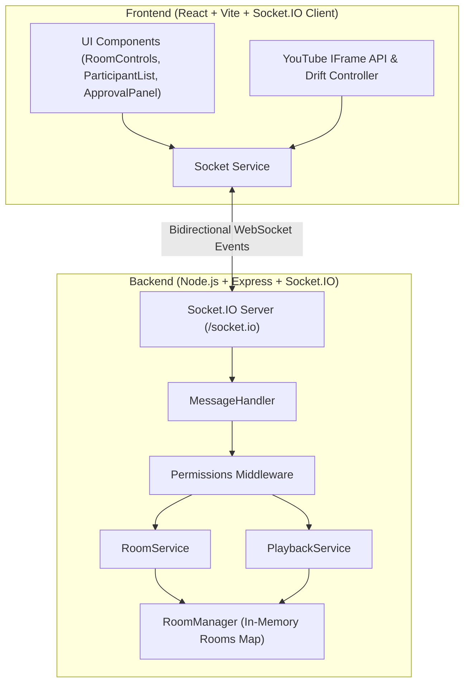
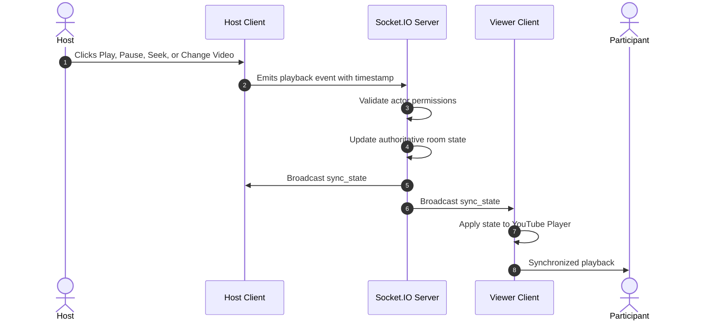

# SyncWatch — Real-Time YouTube Watch Party

> A full-stack, real-time synchronized YouTube watch party application built with **React**, **Express**, **TypeScript**, and **Socket.IO**. Designed with authoritative backend playback state, strict role-based permission enforcement, and an interactive participant action-request approval queue.

**Live Application Demo**: [https://syncwatch-party.onrender.com](https://syncwatch-party.onrender.com) *(Update with your deployed Render service URL)*

---

## 1. Project Overview

SyncWatch allows groups of friends or communities to join a shared virtual room and watch YouTube videos together in real time. 

Key pillars:
- **Authoritative Server State**: The server acts as the single source of truth for current playback time, play/pause status, and the active YouTube video.
- **No Echo Loops**: Remote playback events are distinguished from local user interactions, preventing endless synchronization loops.
- **Drift Correction**: Late joiners and participants with intermittent network jitter are dynamically corrected to within seconds of the authoritative host playback time.
- **Strict Role-Based Security**: Playback controls and participant management permissions are enforced on the backend. Client UI controls reflect permissions, but backend validation prevents unauthorized socket event emissions.
- **Participant Action Requests**: Viewers cannot arbitrarily change playback, but can submit requests (e.g., play, pause, seek, change video) which Host and Moderators can approve or reject in real time.

---

## 2. Technology Stack

### Frontend
- **React 18** & **TypeScript**
- **Vite** for fast bundling
- **Tailwind CSS** for dark, modern SaaS styling
- **Socket.IO Client** for bidirectional real-time events
- **YouTube IFrame Player API** for synchronized embedded playback
- **Lucide React** for clean, accessible icons
- **React Router 6** for SPA routing (`/` and `/room/:roomCode`)

### Backend
- **Node.js** & **Express**
- **TypeScript**
- **Socket.IO** for WebSocket/polling rooms and event handling
- **In-Memory Storage** (`Map`) for ultra-low latency room and participant tracking

### Deployment
- Unified single-service deployment (e.g. Render) where the Express server serves the static React build and powers the Socket.IO server on the same HTTP port.

---

## 3. Architecture & Real-Time Flows

### System Architecture



---

## 4. Roles & Permissions

| Role | Play / Pause | Seek | Change Video | Assign Roles | Remove Participants | Approve Requests |
| :--- | :---: | :---: | :---: | :---: | :---: | :---: |
| **HOST** | ✅ Allowed | ✅ Allowed | ✅ Allowed | ✅ (to Moderator/Participant) | ✅ (anyone except self) | ✅ Allowed |
| **MODERATOR** | ✅ Allowed | ✅ Allowed | ✅ Allowed | ❌ Denied | ✅ (Participants only) | ✅ Allowed |
| **PARTICIPANT** | ❌ *(Request only)* | ❌ *(Request only)* | ❌ *(Request only)* | ❌ Denied | ❌ Denied | ❌ Denied |

> **Backend Enforcement**: Even if a malicious user emits a `play`, `pause`, `seek`, or `change_video` event, the server verifies `canControlPlayback(participant.role)`. Unauthorized calls are immediately rejected with an `operation_error` event.

---

## 5. Real-Time Synchronization Flow



---

## 6. Participant Request & Approval Flow

```mermaid
sequenceDiagram
    autonumber
    actor Participant as Participant
    participant PClient as Participant Client
    participant Server as Socket.IO Server
    participant HClient as Host Client
    actor Host as Host

    Participant->>PClient: Requests Seek or Change Video
    PClient->>Server: Emits request_action
    Server->>Server: Validate request and store in pending queue
    Server->>HClient: Broadcast action_requested
    Host->>HClient: Clicks Approve in Approval Panel
    HClient->>Server: Emits approve_request
    Server->>Server: Verify actor and apply to playback state
    Server->>PClient: Broadcast request_resolved and sync_state
    Server->>HClient: Broadcast request_resolved and sync_state
```

---

## 7. Directory Structure

```text
├── client/
│   ├── src/
│   │   ├── components/
│   │   │   ├── ApprovalPanel.tsx       # Floating request queue for Host/Mods
│   │   │   ├── ParticipantList.tsx     # Live users, role management & room code sharing
│   │   │   ├── RequestActionModal.tsx  # Viewer modal to request actions
│   │   │   ├── RoleBadge.tsx           # Stylized role badges (HOST, MOD, VIEWER)
│   │   │   ├── RoomControls.tsx        # Authoritative playback controls
│   │   │   └── VideoPlayer.tsx         # YouTube IFrame player & drift sync controller
│   │   ├── pages/
│   │   │   ├── Home.tsx                # Landing page (Create & Join room)
│   │   │   └── WatchRoom.tsx           # Main synchronized watch party room
│   │   ├── services/
│   │   │   └── socket.ts               # Singleton Socket.IO client instance
│   │   ├── types/
│   │   │   └── index.ts                # TypeScript interfaces & event payloads
│   │   ├── App.tsx                     # Router configuration
│   │   ├── main.tsx                    # React DOM root
│   │   └── index.css                   # Tailwind styles
│   ├── index.html
│   ├── package.json
│   ├── tsconfig.json
│   └── vite.config.ts
├── server/
│   ├── src/
│   │   ├── classes/
│   │   │   ├── Participant.ts          # Participant entity & status
│   │   │   ├── Room.ts                 # Authoritative room state & request store
│   │   │   └── RoomManager.ts          # In-memory room lifecycle & code generator
│   │   ├── handlers/
│   │   │   └── MessageHandler.ts       # Socket.IO event routing & ack responses
│   │   ├── middleware/
│   │   │   └── permissions.ts          # Pure permission guard functions
│   │   ├── services/
│   │   │   ├── PlaybackService.ts      # Authoritative playback operations
│   │   │   └── RoomService.ts          # Participant & request management
│   │   ├── types/
│   │   │   └── index.ts                # Shared backend contracts
│   │   ├── utils/
│   │   │   └── youtube.ts              # URL parsing and 11-char ID extraction
│   │   ├── socket.ts                   # Socket.IO server initialization
│   │   └── index.ts                    # Express app & static client serving
│   ├── package.json
│   └── tsconfig.json
├── package.json                        # Root monorepo workspace orchestration
├── .gitignore
├── .env.example
└── README.md
```

---

## 8. Local Setup & Installation

### Prerequisites
- **Node.js**: v18.0.0 or higher
- **npm**: v9.0.0 or higher

### Installation

1. Clone or open the repository:
   ```bash
   cd web3task_assignment
   ```

2. Install all dependencies:
   ```bash
   # Install root orchestrator dependencies
   npm install

   # Install server dependencies
   npm install --prefix server

   # Install client dependencies
   npm install --prefix client
   ```

3. Configure Environment Variables:
   ```bash
   cp .env.example .env
   ```
   Default values:
   ```env
   PORT=5000
   NODE_ENV=development
   CLIENT_ORIGIN=http://localhost:5173
   ```

---

## 9. Development Commands

Run frontend and backend simultaneously in development mode:

```bash
# Starts Express backend with tsx watch (port 5000)
# Starts Vite frontend dev server (port 5173 with proxy to 5000)
npm run dev
```

Or run them individually in separate terminals:
```bash
# Terminal 1: Backend
npm run dev:server

# Terminal 2: Frontend
npm run dev:client
```

Open your browser at `http://localhost:5173`.

---

## 10. Production Build & Deployment

To build both client and server for production:

```bash
npm run build
```

This compiles:
1. `client/` into `client/dist/` (static optimized assets)
2. `server/` into `server/dist/` (compiled JavaScript)

Start the production server:
```bash
npm start
```
The server will start on `process.env.PORT || 5000` and automatically serve the built client application and WebSocket connections from the same origin!

### Deploying to Render (Step-by-Step)
1. Push your repository to GitHub.
2. Log into [Render](https://render.com) and click **New +** -> **Web Service**.
3. Connect your GitHub repository.
4. Configure the Web Service settings:
   - **Name**: `syncwatch-party` (or your chosen name)
   - **Environment**: `Node`
   - **Region**: Any (e.g. `Oregon (US West)` or `Singapore`)
   - **Branch**: `main`
   - **Build Command**: `npm run render-build`
   - **Start Command**: `npm start`
5. Under **Environment Variables**, add:
   - `NODE_ENV`: `production`
   *(Render automatically assigns `PORT` and provides SSL out of the box).*
6. Click **Deploy Web Service**. Render will execute `npm run render-build` (which installs all required dependencies including dev/build tools and builds both frontend and backend), then start the unified Express + Socket.IO server.
7. Once deployment finishes, copy the live URL (e.g. `https://syncwatch-party.onrender.com`) and paste it at the top of this `README.md`.

---

## 11. Known Limitations & Architecture Notes

- **In-Memory Storage**: Room and participant states are stored in server memory (`Map`). Rooms persist as long as the server process is active. When the server restarts (e.g., Render free tier spinning down after inactivity), active rooms reset.
- **Single Server Instance**: Because state is stored in-memory on the active node, horizontal multi-instance scaling requires a Redis adapter (`@socket.io/redis-adapter`) and persistent state store. For this 3-day assignment scope, a single instance is purposefully utilized to avoid overengineering.

